<p align="center">
  <a href="https://lightjunction.github.io/lightjunction/"></a>
</p>

[English](README.md) · [中文](README.zh.md) · [Русский](README.ru.md) · [한국어](README.ko.md) · 日本語

# LIghtJUNction

**簡潔 · 美しさ · オープン · 自由 · 暗号化。**

[api.lmm.best](https://api.lmm.best/) 共同創業者。AI、Linux、ネットワークのための小さなツールを作っています。
ここは私のデジタルアシスタントの作業場でもあり、アカウントと資産は私が所有しています。

## コード

- [HumanGrant](https://github.com/LIghtJUNction/humangrant) — AI エージェントへの人による権限付与。
- [LMM Scripts](https://github.com/TokenNotIncluded/lmm-scripts) — AI ツールのインストールと更新。
- [MagicNet](https://github.com/LIghtJUNction/MagicNet) — root 化した Android 向けのネットワークツール。
- [AUL](https://github.com/LIghtJUNction/AUL) — 上流へのフィードバックを扱うライセンスの実験。

[全プロジェクト](https://github.com/LIghtJUNction?tab=repositories) · [プラットフォームのソース](https://github.com/TokenNotIncluded/api.lmm.best) · [スクリプトのコマンド](ONLINE-SCRIPTS.md) · [貢献ガイド](CONTRIBUTING.md)

## 暗号化して連絡

[age 公開受信者](public/age-recipients.txt) · [OpenPGP 公開鍵](pubkey.asc)

[age](https://github.com/FiloSottile/age) と [age-plugin-yubikey](https://github.com/str4d/age-plugin-yubikey) をインストールし、受信者ファイルをダウンロードしてローカルで暗号化します。

```sh
age -R age-recipients.txt -o message.txt.age message.txt
```

`message.txt.age` を **lightjunction.me@gmail.com** に送ってください。YubiKey が必要なのは受信者が復号するときだけです。
秘密鍵、パスワード、復旧コードは送らないでください。

## リンク

[ウェブサイト](https://lightjunction.github.io/lightjunction/) · [記録](https://msg.lmm.best/@lightjunction) · [オープンソースの報奨](https://api.lmm.best/) · [支援](https://donate.lmm.best/?project=lightjunction)

[チャレンジ I — 終了](https://msg.lmm.best/main/184) · [チャレンジ II — 非対称シグナル](https://msg.lmm.best/main/185)

## ライセンス

オリジナルの内容には、OSI 未承認の独自草案 [AUL 1.0-draft.1](LICENSE) を適用しています。以前の MIT 許諾と第三者のライセンスは引き続き有効です。[LICENSING.md](LICENSING.md) を参照してください。
