<p align="center">
  <a href="https://lightjunction.github.io/lightjunction/"></a>
</p>

[English](README.md) · [中文](README.zh.md) · [Русский](README.ru.md) · 한국어 · [日本語](README.ja.md)

# LIghtJUNction

**간결함 · 아름다움 · 개방성 · 자유 · 암호화.**

[api.lmm.best](https://api.lmm.best/) 공동 창업자. AI, Linux, 네트워크를 위한 작은 도구를 만듭니다.
이곳은 제 디지털 비서의 작업 공간이기도 하며, 계정과 자산은 제가 소유합니다.

## 코드

- [HumanGrant](https://github.com/LIghtJUNction/humangrant) — AI 에이전트에 대한 사람의 권한 부여.
- [Stream Check](https://github.com/LIghtJUNction/Inspiration) — Chat Completions 스트림 기록을 로컬에서 비교해 누락된 도구 호출을 찾습니다. [예제 실행](https://lightjunction.github.io/Inspiration/?example=gateway).
- [LMM Scripts](https://github.com/TokenNotIncluded/lmm-scripts) — AI 도구 설치와 업데이트.
- [MagicNet](https://github.com/LIghtJUNction/MagicNet) — 루팅된 Android 기기의 네트워크 도구.
- [AUL](https://github.com/LIghtJUNction/AUL) — 업스트림 피드백을 위한 라이선스 실험.

[모든 프로젝트](https://github.com/LIghtJUNction?tab=repositories) · [플랫폼 소스](https://github.com/TokenNotIncluded/api.lmm.best) · [스크립트 명령](ONLINE-SCRIPTS.md) · [기여 안내](CONTRIBUTING.md)


## AI 에이전트 평가

**[Weight Initialization Benchmark](https://github.com/WeightLang/benchmark)**는 Harbor와 WeightLang을 사용하여 AI 에이전트가 MLP, CNN, 잔차 신경망, Transformer 구조에 맞는 가중치 초기화 알고리즘을 설계하는 능력을 평가하는 초기 단계의 벤치마크입니다. v0.1 프로토콜은 CPU에서 24회의 쌍별 실험으로 후보 초기 가중치를 무작위 초기화 기준과 비교합니다. 제가 [Benchmark Radar에 제출](https://github.com/ktwu01/benchmark-radar/issues/1215)했으며, [PR #1269](https://github.com/ktwu01/benchmark-radar/pull/1269)을 통해 독자 요청 기반 탐색 목록에 추가되었습니다. 실제 AI 에이전트의 평가 결과는 아직 없습니다.

**Binance Benchmark** *(개발 중)*는 AI 에이전트의 Binance 시장 데이터 분석 능력을 평가하는 실험적 프로젝트입니다. Harbor로 작업, 실행 환경과 검증 절차를 구성하고 SSMCP로 평가 클라이언트를 연결합니다. 첫 `market-analysis` 작업의 기본 구조가 마련되었으며, 작업별 테스트는 개발 중입니다.

## 암호화 연락

[age 공개 수신자](public/age-recipients.txt) · [OpenPGP 공개 키](pubkey.asc)

[age](https://github.com/FiloSottile/age)와 [age-plugin-yubikey](https://github.com/str4d/age-plugin-yubikey)를 설치하고 수신자 파일을 내려받은 뒤 로컬에서 암호화하세요.

```sh
age -R age-recipients.txt -o message.txt.age message.txt
```

`message.txt.age`를 **lightjunction.me@gmail.com**으로 보내세요. YubiKey는 수신자가 복호화할 때만 필요합니다.
개인키, 비밀번호, 복구 코드는 보내지 마세요.

## 링크

[웹사이트](https://lightjunction.github.io/lightjunction/) · [기록](https://msg.lmm.best/@lightjunction) · [오픈소스 현상금](https://api.lmm.best/) · [후원](https://donate.lmm.best/?project=lightjunction)

[챌린지 I — 완료](https://msg.lmm.best/main/184) · [챌린지 II — 비대칭 신호](https://msg.lmm.best/main/185)

## 라이선스

원본 자료에는 OSI 승인을 받지 않은 자체 초안 [AUL 1.0-draft.1](LICENSE)이 적용됩니다. 기존 MIT 허가와 제3자 라이선스는 계속 유효합니다. [LICENSING.md](LICENSING.md)를 참고하세요.
