<p align="center">
  <a href="https://lightjunction.github.io/lightjunction/"></a>
</p>

<p align="center">
  English · <a href="README.zh.md">中文</a> · <a href="README.ru.md">Русский</a> · <a href="README.ko.md">한국어</a> · <a href="README.ja.md">日本語</a>
</p>

## LIghtJUNction

**Simplicity · Beauty · Openness · Freedom · Encryption.**

I build open-source tools that are easy to inspect, run, and own. This repository is also the source for my [interactive profile](https://lightjunction.github.io/lightjunction/); the accounts and assets remain mine.

## Terminal playground

Switch between generative Orbit, Rain, and Wave scenes, play Snake, export public keys, or encrypt a message from your terminal.

Linux and macOS:

```sh
installer=$(mktemp) &&
curl -fsSL https://github.com/LIghtJUNction/lightjunction/releases/latest/download/install.sh -o "$installer" &&
sh "$installer" &&
export PATH="$HOME/.local/bin:$PATH"
```

Windows PowerShell:

```powershell
$installer = Join-Path $env:TEMP ("lightjunction-install-{0}.ps1" -f [guid]::NewGuid())
Invoke-WebRequest 'https://github.com/LIghtJUNction/lightjunction/releases/latest/download/install.ps1' -OutFile $installer -UseBasicParsing -ErrorAction Stop
& $installer
$env:Path = "$env:LOCALAPPDATA\Programs\lightjunction\bin;$env:Path"
```

The installers verify the binary checksum and use a directory owned by your user. No Rust or administrator privileges are needed. The `PATH` line applies to the current shell; then run `lightjunction`, `lightjunction snake`, or `lightjunction keys ssh`.

With Rust 1.99.1+, you can also use `cargo install lightjunction --locked`. If unsigned scripts are blocked, use a [manual download](cli/README.md#manual-download). See the [CLI guide](cli/README.md) for controls, version selection, encryption dependencies, and development.

## Project Z

A collection of small, composable Rust libraries for protocols, terminals, systems, and AI tooling. Each component has an explicit scope, with attention to runtime cost, memory use, and dependency size.

## Organizations

Organizations I participate in:

- [TokenNotIncluded](https://github.com/TokenNotIncluded)
- [WeightLang](https://github.com/WeightLang)
- [AstrBotDevs](https://github.com/AstrBotDevs)
- [MemDeco-WG](https://github.com/MemDeco-WG)
- [recipkg](https://github.com/recipkg)

[All repositories](https://github.com/LIghtJUNction?tab=repositories) · [Contributing](CONTRIBUTING.md)

## Contact

[age recipient](public/age-recipients.txt) · [OpenPGP public key](pubkey.asc) · [SSH public keys](https://github.com/LIghtJUNction.keys)

```text
age1yubikey1qgaqxkh32x84vm957584pc0980z3x2agpljavmsh3jwz5q02tlth5suju8n
```

Encrypt a message with the CLI's bundled public keys. For age, install [age](https://github.com/FiloSottile/age) and [age-plugin-yubikey](https://github.com/str4d/age-plugin-yubikey); for OpenPGP, install [GnuPG](https://www.gnupg.org/documentation/).

```sh
lightjunction encrypt age --input message.txt --output message.txt.age
lightjunction encrypt gpg --input message.txt --output message.txt.gpg
```

Encrypting to my age public key does not require a YubiKey; the matching private key and hardware are needed for decryption. The OpenPGP primary fingerprint is `EB21B83AB1E982DF66F08387A67178405F7736FD`. See the [CLI guide](cli/README.md#encrypt-a-message) for file, pipe, and armored output options.

Send the encrypted file to **lightjunction.me@gmail.com**. Never send private keys, passwords, or recovery codes.

## Elsewhere

[Website](https://lightjunction.github.io/lightjunction/) · [Notes](https://msg.lmm.best/@lightjunction) · [Support open-source work](https://donate.lmm.best/?project=lightjunction)

[Challenge I — claimed](https://msg.lmm.best/main/184) · [Challenge II — Asymmetric Signal](https://msg.lmm.best/main/185)

## License

Original material uses [AUL 1.0-draft.1](LICENSE), a custom draft not approved by OSI. Earlier MIT grants and third-party terms remain valid; see [LICENSING.md](LICENSING.md).
