<p align="center">
  <a href="https://lightjunction.github.io/lightjunction/"></a>
</p>

[English](README.md) · 中文 · [Русский](README.ru.md) · [한국어](README.ko.md) · [日本語](README.ja.md)

# LIghtJUNction

**简洁 · 优美 · 开源 · 自由 · 加密。**

[api.lmm.best](https://api.lmm.best/) 联合创始人。做一些 AI、Linux 和网络相关的小工具。
这里也是我的数字助手的工作空间；账号和资产由我持有。

## 命令行工具

`lightjunction` 可以离线导出内置的 SSH、age 和 OpenPGP 公钥，并调用本地安装的 `age` 或 `gpg` 加密文件。

使用 Rust 1.99.1 或更高版本安装：

```sh
cargo install lightjunction --locked
lightjunction
lightjunction keys ssh
lightjunction keys age
lightjunction keys gpg
lightjunction keys --json
```

不带参数运行时会显示帮助并退出。耗时默认输出到标准错误（stderr），因此重定向导出的公钥文件只包含密钥内容。

预编译二进制安装、加密依赖与完整选项见 [CLI 指南](cli/README.md)。

## 致谢

我爱 [OpenAI](https://openai.com/)，也爱 [ChatGPT](https://chatgpt.com/)。真诚感谢 OpenAI 团队创造了这些帮助我学习、探索想法和开发开源项目的工具。[我的 ChatGPT Profile](https://chatgpt.com/u/lightjunction.me)。

## 代码

- [HumanGrant](https://github.com/LIghtJUNction/humangrant) — 让 AI Agent 获得人的授权。
- [Stream Check](https://github.com/LIghtJUNction/Inspiration) — 在本机对比 Chat Completions 流记录，检查丢失的工具调用。[运行示例](https://lightjunction.github.io/Inspiration/?example=gateway)。
- [LMM Scripts](https://github.com/TokenNotIncluded/lmm-scripts) — 安装和更新 AI 工具。
- [MagicNet](https://github.com/LIghtJUNction/MagicNet) — Android root 设备的网络工具。
- [AUL](https://github.com/LIghtJUNction/AUL) — 一项关于上游反馈的许可证实验。

[全部项目](https://github.com/LIghtJUNction?tab=repositories) · [平台源码](https://github.com/TokenNotIncluded/api.lmm.best) · [脚本命令](ONLINE-SCRIPTS.md) · [参与贡献](CONTRIBUTING.md)


## Agent 基准测试

**[Weight Initialization Benchmark（权重初始化基准测试）](https://github.com/WeightLang/benchmark)** 使用 Harbor 和 WeightLang，评估 AI Agent 能否针对 MLP、CNN、残差网络和 Transformer 设计与架构匹配的权重初始化算法。v0.1 在小型 CPU 模型上开展 24 组配对试验，与随机初始化基线比较。我已将其[提交给 Benchmark Radar](https://github.com/ktwu01/benchmark-radar/issues/1215)，并通过上游合并的 [PR #1269](https://github.com/ktwu01/benchmark-radar/pull/1269) 加入读者请求发现列表；目前属于雷达线索，真实 Agent 成绩仍待补充。

**Binance Benchmark**（开发中）是针对 AI Agent 的 Binance 市场数据分析评测项目。使用 Harbor 组织任务、运行环境与验证流程，通过 SSMCP 连接评测客户端。已建立 `market-analysis` 任务骨架，专项测试仍在完善。

## 加密联系

[age 公开接收密钥](public/age-recipients.txt) · [OpenPGP 公钥](pubkey.asc)

```text
age1yubikey1qgaqxkh32x84vm957584pc0980z3x2agpljavmsh3jwz5q02tlth5suju8n
```

安装 [age](https://github.com/FiloSottile/age) 和 [age-plugin-yubikey](https://github.com/str4d/age-plugin-yubikey)，下载接收密钥文件，在本地加密：

```sh
age -R age-recipients.txt -o message.txt.age message.txt
```

将 `message.txt.age` 发到 **lightjunction.me@gmail.com**。只有收件人解密时需要 YubiKey。
请不要发送私钥、密码或恢复码。

## 其他

[网站](https://lightjunction.github.io/lightjunction/) · [动态](https://msg.lmm.best/@lightjunction) · [开源悬赏](https://api.lmm.best/) · [支持](https://donate.lmm.best/?project=lightjunction)

[挑战 I — 已领取](https://msg.lmm.best/main/184) · [挑战 II — 非对称信号](https://msg.lmm.best/main/185)

## 许可

原创内容采用 [AUL 1.0-draft.1](LICENSE)，这是未经 OSI 批准的自定义草案。此前的 MIT 授权和第三方许可继续有效，详见 [LICENSING.md](LICENSING.md)。
